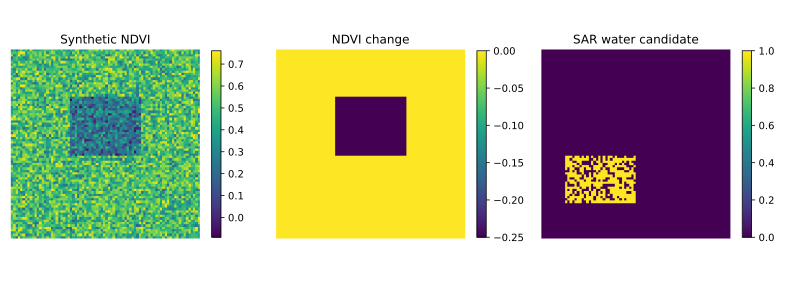

# Environmental Change and Water Screening | South Florida Methods

Python utilities for vegetation/moisture indices, NDVI-change classes, SAR new-water candidates, Random Forest evaluation and vector reprojection. The focus is a repeatable analysis structure for environmental monitoring.

## Implemented components

| Module | Function |
|---|---|
| `indices.py` | NDVI, NDMI, NDWI, MNDWI, NBR and NDBI with safe division |
| `change_detection.py` | NDVI-change categories; invalid pixels remain unclassified |
| `flood_mapping.py` | Pre/post dB difference, threshold candidates and terrain screening |
| `landcover_rf.py` | Train Random Forest and report classification metrics |
| `gis_automation.py` | Reproject vector inputs and discover GeoTIFFs |
| `run_demo.py` | Run aligned synthetic layers and write a GeoTIFF, summary and preview |

## Quick start

```bash
python -m pip install -r requirements.txt
python scripts/run_demo.py
python -m pytest -q
```



The demonstration outputs `synthetic_environmental_layers.tif` with NDVI, NDMI, MNDWI and SAR-candidate bands. Its coordinates and values are fictional; it is not a completed South Florida event assessment.

## Satellite pathways

Use [monthly Sentinel-2 monitoring](../sentinel2-timeseries/), [vegetation change](../vegetation-change/) and [orbit-matched SAR change](../sentinel1-sar-change/) for Earth Engine processing of public imagery. Use [raster classification](https://github.com/belbasepriyanka/geospatial-land-cover-ml) with independently labeled samples for mapped class predictions.

## Scope and validation

A full regional assessment needs chosen boundaries/dates, aligned observations and independent reference data. Drought attribution, flood susceptibility modeling and long-term Landsat analysis are possible extensions, not implemented results of this demo. A radar decrease and a vegetation-index decline are screening signals, not confirmed causes.

The optional satellite notebook also needs `python -m pip install -r requirements-earthengine.txt` and Earth Engine authorization. It is separate from the tested local demo.

The optional satellite notebook also needs `python -m pip install -r requirements-earthengine.txt` and Earth Engine authorization. It is separate from the tested local demo.
