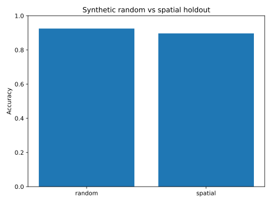
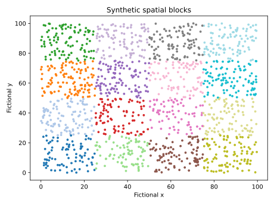

# Spatial Validation Benchmark for Geospatial ML

Compare random and spatial-block holdouts on the same generated feature table. Both splits use the same model settings; spatial blocks remain disjoint between training and evaluation.

## Run

```bash
python -m pip install -r requirements.txt
python scripts/run_demo.py
python -m pytest -q
```

The script writes the input table, held-out predictions, accuracy/F1 metrics and spatial group lists. A separate `spatial_cv` function supports five-fold grouped evaluation.




## Reading the result

Use [the generated metrics](results/benchmark_metrics.csv) and [group memberships](results/spatial_groups.json) to inspect the comparison. A spatial split does not necessarily reduce every metric; the result depends on sampling geometry, signal strength and the intended transfer task.

Coordinates, labels and predictors are synthetic. These results illustrate evaluation design and are not evidence of accuracy for a real region.
