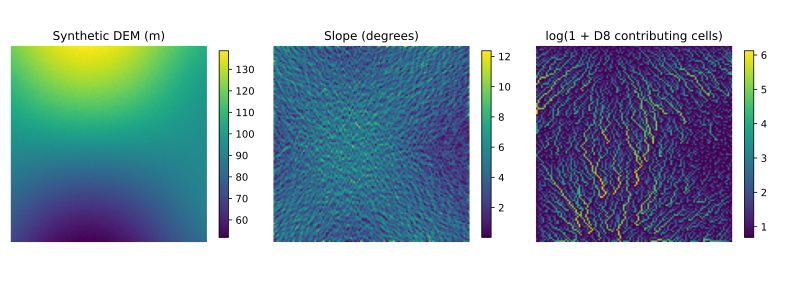

# Terrain and Hydrology Modeling

Calculate slope with physical cell spacing and route contributing area using the steepest downslope D8 neighbor. Outputs include a DEM, slope, receiver grid and contributing-cell counts.

## Run

```bash
python -m pip install -r requirements.txt
python scripts/run_demo.py
python -m pytest -q
```

The demo uses a generated DEM with a declared 10 m cell size. It saves `outputs/terrain_arrays.npz`, `outputs/summary.json` and the quicklook below.



## Methods

Slope is calculated from horizontal and vertical elevation gradients in metres. D8 receivers follow positive elevation drops divided by neighbor distance. Cells are accumulated in descending elevation order. Tests check slope units and contributing-area conservation on a known plane.

## Interpretation

This implementation leaves pits and flats as sinks and does not condition the DEM. Stream thresholds, depression handling, flat routing and watershed outlets require a separate documented design before operational hydrology. The DEM and derived outputs are synthetic and are not flood-hazard predictions.
